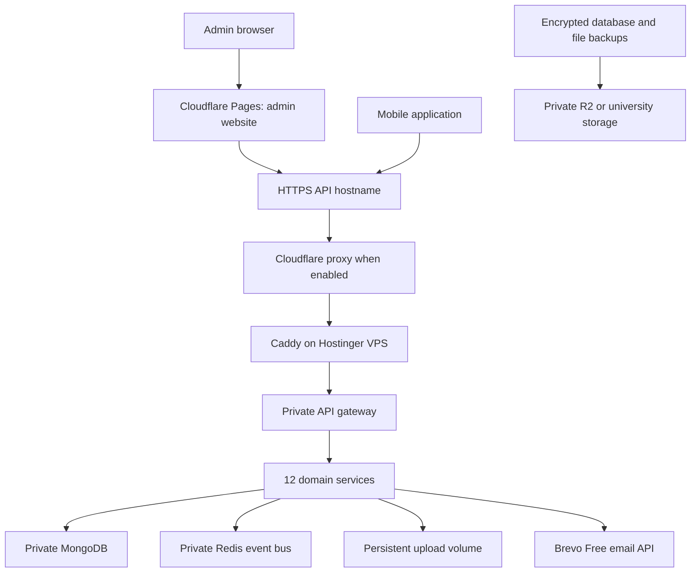

# BGSC: checklist from the current codebase to public launch

Updated: October 25, 2026, for a student budget. All boxes start unchecked: finding code in the repository does not mean its behavior has been verified.

Work through this in order. Mark an item complete only after you can show its result. For a feature you deliberately exclude from launch, write `Deferred`, remove its entry points from both frontends, and record why. Keep a short bug list with the screen, reproduction steps, expected result, actual result, and fix commit.

**Budget decision:** Pay for the Hostinger VPS, the domain (maximum ₹1,200/year including renewal taxes/fees), and Android store registration. Use free plans or the resources already included in the VPS for everything else initially. The VPS and domain renew; Google Play's registration fee is one-time. Apple membership normally renews annually, so an iOS store release needs a separate decision.

Read [the detailed student hosting setup guide](STUDENT_HOSTING_SETUP.md) alongside this checklist. It gives the dashboard settings, environment values, server commands, provider setup, and checks for the revised architecture. Examples are instructions to perform later, not configuration already added to the application.

Cloudflare supplies DNS, static website hosting, certificates, and optional proxy protection. MongoDB and Redis will run privately on the paid VPS. Free outgoing email comes from Brevo. Cloudflare's free email routing can forward incoming support mail; sending to arbitrary members through Cloudflare Email Service requires a Workers Paid plan. [Cloudflare email pricing](https://developers.cloudflare.com/email-service/platform/pricing/).

**Recommended starting setup**

| Part | Starting choice | What it does |
|---|---|---|
| Server | Hostinger Linux VPS; evaluate KVM 2 against measured usage | Paid compute for Docker, backend, MongoDB, Redis, and upload files |
| Domain | An available, non-premium `.in` name | Gives your project a permanent address |
| DNS | Cloudflare Free | Connects your domain names to the server |
| Admin website | Cloudflare Pages Free | Hosts the static build of `web/`; no separate web hosting subscription |
| Public information site | A second small Cloudflare Pages project | Hosts privacy, support, download, and terms pages |
| API web server | Caddy on the VPS | Forwards API requests to the private gateway and renews the origin certificate |
| HTTPS | Cloudflare-managed website certificates plus Caddy's free origin certificate | Encrypts the website and API connections |
| Backend | Existing Docker Compose stack | Runs the gateway and 12 domain services |
| MongoDB | Existing MongoDB container on the VPS | No separate database subscription; consumes VPS RAM/disk and needs backups |
| Redis | Existing authenticated Redis container on the VPS | Cross-service event delivery and any configured caching; no separate Redis subscription |
| Transactional email | Brevo Free | Currently 300 email sends/day shared by verification, reset, and feedback |
| Incoming support email | Cloudflare Email Routing to an existing team inbox | Free incoming forwarding; does not provide a free outgoing mailbox |
| Email verification | Existing secure email links, delivered through Brevo | Proves access to the email address; preserves the current API contract |
| Phone OTP | Deferred unless separately funded | No free production SMS delivery is assumed; phone numbers remain unverified |
| Images and media | Existing private/public upload layout on the VPS | No separate storage subscription or storage migration for the initial release |
| Off-server backups | Private Cloudflare R2 Standard within its included allowance, or approved university storage | R2 is metered; keep storage/operations within allowance and review billing before enabling |
| Mobile builds | Expo EAS Free within quota, or local builds | No paid build subscription assumed |
| Android distribution | Google Play | US$25 one-time registration, subject to checkout currency/taxes |
| iOS distribution | Separate annual budget or an eligible institution's approved waiver | Apple normally charges US$99/year; being an individual student does not itself waive the fee |

Use one VPS initially if measured resources are sufficient. Free software on that VPS still consumes its paid CPU, memory, disk, and bandwidth. Cloudflare D1 is a different database with SQLite semantics; it does not run the existing MongoDB models. Cloudflare caching also does not replace this application's Redis event bus. [D1 overview](https://developers.cloudflare.com/d1/).

Brevo's free plan currently includes 300 sends/day; unused sends do not carry over, and quota exhaustion can delay transactional mail. Reserve capacity for recovery/resends and spread onboarding across days if necessary. Free SMS/WhatsApp trials are not a sustainable production dependency. [Brevo free plan](https://help.brevo.com/hc/en-us/articles/208589409-About-Brevo-s-pricing-plans), [email quota behavior](https://help.brevo.com/hc/en-us/articles/208580669-FAQs-What-are-the-limits-of-the-Free-plan), [example OTP delivery pricing](https://www.twilio.com/en-us/verify/pricing).

Cloudflare Pages Free currently allows 500 builds/month. R2 Standard includes 10 GB-month storage, one million Class A operations, and ten million Class B operations per month; usage beyond allowances is billed. Its free allowance is not a hard spending cap. Avoid paid Workers, Images, Stream, advanced certificates, and paid add-ons unless the team explicitly changes the budget. [Pages limits](https://developers.cloudflare.com/pages/platform/limits/), [R2 pricing](https://developers.cloudflare.com/r2/pricing/).

Google Play registration is one-time; Apple Developer membership is normally annual. An accredited institution may qualify for Apple's organizational fee waiver, but individual students do not qualify on that basis alone. Ask the institution to own and manage any institutional account. [Google Play registration](https://support.google.com/googleplay/android-developer/answer/6112435), [Apple enrollment](https://developer.apple.com/programs/enroll/), [Apple fee waiver](https://developer.apple.com/help/account/membership/fee-waivers/).



**Domain and server prices checked for this checklist:** Hostinger's `.in` page lists ₹899/year renewal; the displayed ₹1 first-year offer has term conditions. Buy only after the checkout confirms that the normal renewal, including taxes and required fees, fits ₹1,200/year. Cloudflare has a free DNS plan. Hostinger's VPS page currently displays KVM 2 with 2 vCPU and 8 GB RAM at ₹779/month, renewing at ₹1,199/month under its displayed offer. Confirm the upfront term, renewal total, taxes, region, and backup charges before paying. These are current advertised prices, not guaranteed quotes. [Domain pricing](https://www.hostinger.com/in/tld/in-domain), [Cloudflare Free](https://www.cloudflare.com/plans/free/), [VPS pricing](https://www.hostinger.com/in/vps-hosting).

**A few words used below**

| Word | Meaning here |
|---|---|
| Domain registrar | The company where you buy and renew the domain |
| DNS / nameservers | The directory that tells devices where your domain is hosted |
| Subdomain | Another address under your domain, such as `api.example.in`; no second domain purchase is needed |
| VPS | A rented Linux computer you manage |
| Reverse proxy | The public web server that forwards requests to the private backend |
| HTTPS / TLS certificate | The encrypted browser/app connection and its server identity certificate |
| Staging | A private test deployment with disposable data |
| Production | The deployment used by real members |
| Environment variable | A setting supplied to an application, such as its API URL |
| CI | Automated checks run when you push or propose code changes |

**1. Preserve the current work and decide what launches**

- [ ] Review `git status`: there are already many modified and untracked backend, mobile, and web files. Preserve intended work in reviewed commits before making a release.
- [ ] Choose the first launch platforms: Android, iOS, and/or a member website. Treat `web/` as the admin panel; it is not automatically a member website.
- [ ] List the features your first event needs: registration, teams, attendance, results, points, announcements, and any required challenges, auctions, or brackets.
- [ ] Record the budget scope: email/password login plus email verification launch first. Keep Google/Strava only if their full flows are ready. Phone SMS verification and WhatsApp delivery are deferred unless funded separately; hide their actions without treating an unverified number as verified.
- [ ] Assign someone to own backend fixes, frontend fixes, hosting, manual testing, and launch support. One person can own several.
- [ ] Create test accounts for two ordinary members, two admins assigned to different events, and a founder/core user. Use test addresses and phone numbers you control.
- [ ] Create the bug list. Treat broken signup/recovery, unauthorized access, duplicate point changes, lost uploads, and leaked private data as launch blockers.

Done when: the launch scope, intended release files, owners, and test accounts are clear.

**2. Fix the known backend and account-flow gaps first**

These findings come from the current files, rather than the older completion percentages in the documentation.

| Finding | Current evidence | Required next step |
|---|---|---|
| Verification and password reset emails do not send in production | `Backend/apps/auth-service/src/auth/mailer.service.ts` has production stubs | Implement real delivery, configuration, and failure handling |
| Feedback emails do not send in production | `Backend/apps/feedback-service/src/feedback/mailer.ts` has production stubs | Connect receipts and responses to the same chosen provider |
| Phone OTP delivery is a production stub | `sendPhoneOtp` in `Backend/apps/auth-service/src/auth/auth.service.ts` | Hide the phone-verification UI and make sending fail clearly while deferred; never claim dispatch succeeded |
| Verification/reset browser destinations are missing from the admin router | `web/src/app/router.tsx` lacks `/verify-email` and `/reset-password` | Add public pages that finish the existing backend flows |
| Mobile Google login deliberately throws an unavailable error | `mobile/src/repositories/AuthRepository.ts` | Complete the mobile flow or hide the action |
| Browser Google callback destination is missing | Backend redirects to `/auth/callback`; the web router lacks it | Implement the callback/exchange page if Google login launches |
| Strava callback landing needs verification | Backend uses `FRONTEND_URL/settings/integrations`; admin router lacks this route | Implement a safe web-to-app handoff if Strava launches |
| Gateway is configured for direct clients | `Backend/src/index.ts` deliberately does not trust a proxy | Update trusted-proxy handling for the chosen deployment |
| CI references an older architecture | `.github/workflows/backend-ci.yml` uses lowercase paths, PostgreSQL, and absent scripts | Update it for the current MongoDB backend and actual commands |
| Staging workflow targets the old host | `.github/workflows/deploy-staging.yml` watches `backend/**` and calls Render | Replace or retire it when Hostinger deployment is ready |

- [ ] Implement email delivery without logging tokens, passwords, OTPs, or complete reset links in production.
- [ ] Use Brevo's HTTPS transactional API from auth and feedback services. Add planned `BREVO_API_KEY`, sender, and reply-to settings to configuration/Compose; these names are proposed implementation work, not existing working settings.
- [ ] While SMS is deferred, return a clear unavailable response from the phone send route in production, remove the false-success stub behavior, and ensure signup/event registration does not silently require phone verification.
- [ ] Preserve generic responses on resend/reset requests so visitors cannot discover registered email addresses. Record delivery failures privately and provide a way to retry.
- [ ] Confirm retries after delivery failures do not strand a newly created account or invalidate a working recovery flow unexpectedly.
- [ ] Keep email verification link based unless you deliberately redesign it. The current email verification API accepts a token; the six-digit OTP is for phone verification.
- [ ] Make the verification page call `POST /auth/verify-email` and show success, expired, invalid, and already-used outcomes clearly.
- [ ] Make the reset page accept the email token and new password, call `POST /auth/reset-password`, and offer a new reset request if needed.
- [ ] Ensure these pages work while signed out and for ordinary members. They must not be trapped behind the admin role guard.
- [ ] Refresh the member's verified status after they return to the app from their email.
- [ ] If Google launches, complete the existing one-time login-code exchange and the app redirect. Keep session tokens out of redirect URLs.
- [ ] If Strava launches, complete the callback, one-time linking handoff, cancellation/error handling, and account unlinking.
- [ ] Add every new provider setting to backend configuration, `.env.example`, and the relevant Compose service environment. Compose does not automatically forward every value in its `.env` into containers.

Done when: included signup/recovery/social flows finish without reading development logs, and deferred phone verification cannot pretend to succeed.

**3. Confirm the missing APIs and connect their callers**

Use [the current API registry](frontend-api-and-design-registry.md) as a starting map, then compare actual route files with both frontend clients. The core APIs already cover many features; confirm the exact missing behavior before adding another endpoint.

- [ ] For every visible mobile screen and admin action, write down its method, URL, required role, request fields, success response, and expected errors.
- [ ] Flag missing routes, wrong field names, missing response fields, unsupported filters, and missing gateway forwarding separately in the bug list.
- [ ] Confirm all frontend calls target the gateway with paths such as `/events` and `/auth/login`. The current gateway has no `/api` prefix.
- [ ] Address the global-rank gap if the member's own rank is shown: `findMyGlobalRank` currently searches at most five pages of 100 entries. Add a direct current-user rank API or change the UI so members beyond that cap are not shown as unranked. Preserve filters and tie rules.
- [ ] Review the mobile “my bids” workaround. If that view launches and scanning every lot is insufficient, add a paginated current-user bids API with event filtering and ownership checks.
- [ ] Verify the recent media fields (`liked_by_me`, `mine=true` pending uploads) and `DELETE /users/me/avatar` through their real callers; these additions already exist in the working tree.
- [ ] Verify profile completion, event forms, personal registration history, points history, unread counts, moderation, and challenge review against the actual enabled screens.
- [ ] For each API addition, finish validation, authorization, controller/service behavior, gateway wiring if needed, response types, mobile/web callers, and a focused regression check together.
- [ ] Update the API registry after changes. Record an explicit decision for every remaining gap: fixed, hidden for launch, or accepted with an accurate UI.
- [ ] Keep push notification endpoints out of the release scope unless push itself is included. In-app notifications are a separate feature.

Done when: every enabled action has a working API and no user-facing result depends on fake data.

**4. Review backend correctness and permissions**

- [ ] Validate untrusted IDs, request bodies, search/filter values, upload sizes, and page sizes. Return clear errors for malformed requests.
- [ ] Confirm password hashing, expiring verification/reset tokens, refresh rotation, logout, suspension, deletion, and restoration match the intended account rules.
- [ ] Test the actual session model with phone and admin/browser use. Decide whether a newer login is expected to replace an older session and explain that behavior to testers.
- [ ] Check sensitive actions use the current account's permissions, including after a role change or suspension; changing a role in the browser must grant nothing.
- [ ] Check event admins can only manage their permitted events. Test another event's registrations, attendance, scores, teams, and files.
- [ ] Check registration capacity and waitlists under simultaneous requests. Repeated requests must not create duplicate participants or consume extra seats.
- [ ] Check repeated attendance, result submission, challenge approval, cancellation, and investment requests cannot award or spend points twice.
- [ ] Check private registration uploads require their authenticated owner or an authorized admin. Do not serve the entire upload volume directly from Caddy.
- [ ] Confirm oversized files and disallowed file content are rejected, filenames cannot escape their storage directory, and pending moderation is not publicly accessible.
- [ ] Confirm required unique indexes are built successfully before a service accepts requests. Document any data changes needed for the release.
- [ ] Confirm Redis authentication and shared event-signing keys match across services.
- [ ] Stop a consumer, perform a relevant operation, restart it, and check that replay eventually restores the expected state without duplicate rewards. Current replay sweeps run about every five minutes and cover a seven-day window; this is a recovery limit to understand.
- [ ] Confirm errors and logs expose no secrets, internal stack details, or private member data to clients.

Done when: permissions, account behavior, participation, file access, and point changes remain correct during failures and retries.

**5. Establish the local checks and repair CI**

Run the test commands on your development computer or a disposable test environment. The existing live-check runner drops its `bgsc_live` database, starts services on ports 3000–3012, and writes test data. Never point it at the public deployment or a production database server.

- [ ] Use the documented Node version and run `npm ci` separately in `Backend/`, `web/`, and `mobile/` using their lockfiles.
- [ ] Start the local MongoDB and Redis test infrastructure according to [the local guide](local-dev-guide.md); keep credentials in the ignored backend `.env`.
- [ ] Run the backend build, type check, selfchecks, HTTP/database tests, and full-stack check; resolve failures rather than marking them expected without explanation.

```bash
# Run inside Backend/, against local test infrastructure
npm run build
npm run typecheck
npm test
npm run live-check
```

- [ ] Run the admin production build and lint checks.

```bash
# Run inside web/
npm run build
npm run lint
```

- [ ] Run mobile type checking (`npx tsc --noEmit` inside `mobile/`), the existing `mobile/scripts/*.selfcheck.cjs` checks, and Expo Doctor (`npx expo-doctor`). Fix dependency compatibility before building a release.
- [ ] Review `web/scripts/web-admin-smoke.mjs` before reuse: it contains a hardcoded fixture login, expects a prepared local stack, and changes data. Make its fixtures repeatable before including it in CI; never run it against production.
- [ ] Fix CI paths to use `Backend/`, its lockfile, current Node requirements, MongoDB/Redis fixtures, actual environment names, and scripts that exist.
- [ ] Include the shared package build, relevant frontend checks, and Docker image build in the automated release checks.
- [ ] Run dependency vulnerability checks and investigate findings that affect deployed code; review updates before merging them.
- [ ] Require passing checks on the exact release commit and produce identifiable backend and frontend artifacts from it.

Done when: the release can be checked and built from a clean checkout, without relying on uncommitted files or a developer's database.

**6. Buy the domain and Hostinger VPS**

- [ ] Choose an available domain that is easy to spell. Check the normal renewal price, not only the introductory price.
- [ ] Keep the final annual domain renewal within ₹1,200, including taxes and required fees. Do not buy optional bundles just to obtain a promotional domain rate.
- [ ] Confirm the registrar supports external nameservers and publishing Cloudflare's DNSSEC delegation record for your chosen domain extension.
- [ ] Register the domain in an account you control, enable two-factor authentication, verify the contact address, and enable renewal reminders or auto-renewal.
- [ ] Use a recovery email outside your new domain, so a domain outage does not prevent account recovery. Save account recovery codes securely.
- [ ] Compare Hostinger VPS plans using the full upfront bill and renewal. Evaluate KVM 2 as a starting candidate, then measure; 8 GB is not a capacity guarantee for this service stack.
- [ ] Select a server region close to your users where available. Choose a supported Ubuntu LTS release compatible with Docker and Caddy.
- [ ] Record the VPS IP, SSH access method, billing date, renewal amount, and how to open Hostinger's recovery console.
- [ ] Choose an off-server backup destination within a free allowance: private R2 Standard with billing controls, or institution-approved protected storage. Check that database plus media backups and retained copies fit; a backup stored only on this VPS is insufficient.
- [ ] Use one VPS for production initially. Run staging locally or in an isolated stack on the same VPS only if resources allow; keep separate databases, Redis instances, credentials, networks, volumes, ports, and signing keys. A second paid VPS is not assumed.
- [ ] Create free Cloudflare, Brevo, and Expo accounts under accountable project ownership. Apply for GitHub Education if eligible, but do not make launch depend on approval or expiring student credits.

Done when: you own the domain and VPS, can recover both accounts, and know the recurring total.

**7. Secure and prepare the server before deploying**

- [ ] Update the operating system and configure routine security updates.
- [ ] Create an SSH key and a named administrator account with `sudo`. Prove login works in a second terminal before disabling password/root SSH access.
- [ ] Retain recovery-console access. Restrict SSH to your administrative IP or a suitable private access method where practical.
- [ ] Configure the Hostinger network firewall and host firewall: allow web traffic on 80/443; allow SSH only as intended; keep database and application ports private.
- [ ] Install Docker Engine, Compose, and Caddy from their supported installation instructions. Limit access to Docker administration, which grants powerful server access.
- [ ] Confirm ports 3000–3012, 27017, 6379, and development tools are unreachable from an outside network, including IPv6 if enabled.
- [ ] Account for Docker's published-port rules: a host firewall alone may not block ports published by Docker. Remove unnecessary mappings or bind them to loopback. [Docker firewall documentation](https://docs.docker.com/engine/network/packet-filtering-firewalls/).
- [ ] Add disk usage monitoring, container log rotation, and sensible resource limits after measuring the application. Leave resources for MongoDB and the operating system.
- [ ] Set up a restricted way to fetch release artifacts from your private repository/registry. Keep personal administrator tokens off the server where possible.

Done when: you can administer the VPS safely and only the intended public ports are reachable.

**8. Set up DNS and HTTPS**

Replace every `example.in` below with the domain you actually buy. These are examples, not registered project addresses.

| Address | Purpose | Example DNS record |
|---|---|---|
| `example.in` | Cloudflare Pages information/privacy/download site | Add the domain through the site's Pages Custom domains settings; use the generated record |
| `admin.example.in` | Cloudflare Pages build of `web/` plus public account-link pages | Add through Pages; normally `CNAME admin` to its assigned `pages.dev` hostname |
| `api.example.in` | Production gateway | `A`, name `api`, value VPS IPv4 |
| `staging-admin.example.in` | Separate staging Pages project | Add through the staging project's Custom domains settings |
| `staging-api.example.in` | Private test gateway | `A`, name `staging-api`, value staging IPv4 |

- [ ] Add the domain to Cloudflare's free plan and copy existing records if the domain already handles email or another website.
- [ ] At the registrar, change the domain's nameservers to the exact pair assigned by Cloudflare. Once active, manage these records in Cloudflare.
- [ ] Add only the addresses you need from the table. Use DNS-only mode initially for the VPS API record; attach website domains in Pages rather than pointing them to the VPS.
- [ ] Check DNS resolves to the intended server using `dig` or `nslookup` and from another network. Allow for DNS caches while changes spread.
- [ ] Add IPv6 `AAAA` records only after IPv6 routing, firewall rules, and HTTPS have been tested. Remove stale addresses pointing elsewhere.
- [ ] Configure Caddy for API hostnames, proxying to the private gateway. Caddy supports automated origin certificate issuance and renewal; Pages manages certificates for its attached website domains. [Caddy HTTPS documentation](https://caddyserver.com/docs/automatic-https), [Pages custom domains](https://developers.cloudflare.com/pages/configuration/custom-domains/).
- [ ] Confirm each hostname has a valid certificate and HTTP redirects to HTTPS. Test from a device that has never connected to the server.
- [ ] Enable DNSSEC in Cloudflare, publish the generated DS delegation details at the registrar, and verify validation succeeds. Check support for the chosen extension; mismatched records can make the entire domain fail to resolve. [Cloudflare DNSSEC](https://developers.cloudflare.com/dns/dnssec/), [Hostinger DNSSEC instructions](https://www.hostinger.com/support/3667267-how-to-use-dnssec-records-at-hostinger/).
- [ ] If enabling Cloudflare's web proxy, use Full (strict) TLS after the origin certificate works. Confirm automated certificate renewal still works. [Cloudflare TLS guidance](https://developers.cloudflare.com/ssl/origin-configuration/ssl-modes/full-strict/).
- [ ] If enabling that proxy, verify real client IP handling again, avoid browser challenges on app/API requests, and bypass caching for authenticated/private API responses. Check upload limits against your media size limits.
- [ ] If relying on Cloudflare to protect the origin, restrict origin web access appropriately and test it; knowing the server IP must not bypass the protection you rely on. Preserve administrative recovery and certificate renewal.
- [ ] Enable two-factor authentication on Cloudflare and registrar accounts, use limited DNS API tokens where needed, and retain domain renewal reminders.

DNSSEC protects DNS answers. HTTPS protects the connection. Backend permissions protect member data. All three have separate jobs.

Done when: all selected addresses resolve, HTTPS works, DNSSEC validates where supported, and DNS changes are secured.

**9. Configure the backend for staging and production**

- [ ] Create a production Compose override and an environment file stored outside version control. The existing Compose file defaults to development and names the database `bgsc_dev`. Keep the existing MongoDB/Redis containers as the initial database/bus plan; no separate managed subscription is needed.
- [ ] Use separate production and staging database names, credentials, Redis instances, upload volumes, and signing keys. Never connect both stacks to one shared event channel with matching keys.
- [ ] Set `NODE_ENV=production` on every publicly deployed application service. Use fresh strong values for JWT secrets, internal signing token, Mongo credentials, and Redis password.
- [ ] Keep database connection strings correctly encoded. The current Compose Mongo URI interpolates its password directly; use a strong URL-safe password there or fix the URI construction before using arbitrary characters.
- [ ] Plan a dedicated Mongo application account with the permissions the application needs, including its index setup; keep database administrative access separate.
- [ ] Use the private Docker names (`mongodb`, `redis`, and domain-service names) for container-to-container connections. Do not create public DNS records for database or Redis access.
- [ ] Keep Redis reachable over its existing TCP protocol with pub/sub support. Cloudflare KV, D1, CDN caching, and a REST-only cache are not configuration replacements for that connection.
- [ ] If Caddy runs on the host, publish the gateway only on `127.0.0.1:3000` and proxy there. If Caddy runs in Docker, use private container networking instead. Verify the final merged Compose configuration does not retain a second public gateway mapping.
- [ ] Keep domain-service ports private and disable optional database administration tools in production.
- [ ] Configure the gateway to trust only the actual proxy path, with forwarded headers set by trusted proxies. Test two different client IPs and attempts to spoof forwarded headers; do not blindly enable `trust proxy=true`.
- [ ] Set `API_BASE_URL=https://api.example.in` and the exact production origins in `CORS_ORIGIN`. Do not use a wildcard with credentials. Include any public account-link page origin that calls the API.
- [ ] For the suggested layout, set `FRONTEND_URL=https://admin.example.in` after adding its public verification/reset/callback routes. Confirm this shared setting also points Strava and other generated links to working pages.
- [ ] Set exact HTTPS Google and Strava callback URLs if included, and register those exact addresses with their providers.
- [ ] Set provider credentials only on the backend services that need them. Supply the Strava token encryption key if Strava launches and include it in secure recovery material.
- [ ] Mount persistent MongoDB data and the shared uploads volume, retaining private registration-file access through the backend.
- [ ] Build and deploy a versioned backend image from the checked release commit. Keep the previous image available for rollback.
- [ ] Confirm every container becomes healthy, indexes build, Redis connects, internal calls succeed, and no service repeatedly restarts.
- [ ] Verify `/internal/*` remains inaccessible from the public gateway and the proxy does not expose domain services directly.
- [ ] Register and verify the real initial administrator, then run the existing founder bootstrap against the intended environment. Remove demonstration administrators and fixture data.

Done when: the isolated staging backend runs in production mode through HTTPS with real secrets and persistent storage.

**10. Activate free email and included external services**

- [ ] Create Brevo Free, activate transactional sending as required, authenticate the sender domain, and keep the account on its free email plan. Do not buy SMS credits or paid marketing features as part of this setup.
- [ ] Copy Brevo's exact ownership, DKIM, and DMARC records into Cloudflare. Brevo currently does not require SPF/MX records for shared-IP domain authentication; do not invent records or replace incoming-mail records with unrelated examples. Keep any existing SPF/DMARC record valid and singular. [Brevo domain authentication](https://help.brevo.com/hc/en-us/articles/12163873383186-Authenticate-your-domain-with-Brevo-Brevo-code-DKIM-DMARC).
- [ ] Set up Cloudflare's incoming Email Routing for `support@example.in` to a verified existing team inbox. Preserve the routing records Cloudflare supplies. Reply through the feedback API using Brevo, or use the existing inbox identity; forwarding does not configure outgoing mail as `support@example.in`.
- [ ] Use an authenticated sender such as `BGSC <accounts@example.in>` and `support@example.in` as Reply-To. Keep project-account recovery tied to an external address.
- [ ] Keep tracking disabled for sensitive auth links if it would rewrite or expose tokens. Check links are generated with the intended HTTPS frontend address.
- [ ] Test signup verification, verification resend, password reset, feedback receipt, and staff response to actual inboxes, including your intended campus email provider.
- [ ] Check inbox/spam placement, provider rejection, quota exhaustion, delayed mail, expired links, repeat clicks, and resend behavior. Alert on repeated delivery failures.
- [ ] Budget the shared 300/day allowance across production and staging. Initially limit planned onboarding to 200 new members/day, leaving 100 sends for recovery, resends, feedback, and testing; lower that onboarding cap if actual usage needs more reserve.
- [ ] Keep announcement blasts in-app, so they cannot consume the auth/recovery email allowance. Count provider requests and delivery outcomes; do not assume an accepted API request means the recipient received it immediately.
- [ ] Test quota rejection/delay using controlled failure simulation, not hundreds of real messages. A queued reset email that arrives after token expiry must have a usable new-request path.
- [ ] Verify deferred phone-OTP actions are absent from web/mobile, the send API returns an unavailable error, and no account is marked phone-verified without a real verification.
- [ ] If phone OTP becomes mandatory, explicitly reopen the budget decision, choose a real provider, complete its applicable India sender/template onboarding, and test delivery/expiry/attempt limits before enabling it. Email verification cannot prove phone-number ownership. [Example India SMS requirements](https://www.twilio.com/en-us/guidelines/in/sms).
- [ ] Test Google login in both admin browser and an installed mobile build if included. Expo Go alone is not sufficient for the production OAuth redirect flow. [Expo OAuth guidance](https://docs.expo.dev/guides/authentication/).
- [ ] Test Strava connect, denied consent, expired credentials, sync, proof submission, and disconnect if included.
- [ ] Verify in-app announcement/notification delivery and unread state independently of WhatsApp or push. Enable and test those additional channels only if included in this release.

Done when: email and included integrations work within free allowances, recovery has spare capacity, and phone/SMS/WhatsApp are not represented as free working services.

**11. Connect and host the admin website**

- [ ] Build `web/` with staging values first, then production values. These Vite values are included at build time:

```dotenv
# web production build inputs; replace the example domain
VITE_API_URL=https://api.example.in
VITE_USE_MOCK=false
```

- [ ] Confirm every admin service uses real API responses and that network failures produce an error message rather than a convincing empty/success state.
- [ ] Create a Cloudflare Pages project from the GitHub repository: root directory `web`, build command `npm run build`, output directory `dist`, supported Node 22 runtime, and the reviewed production branch. Do not upload `Backend/` into Pages. See the setup guide for exact fields.
- [ ] Set production and staging frontend environment values separately and deploy a fresh build after changing them. Attach `admin.example.in` through Pages Custom domains and verify its certificate.
- [ ] Check Pages single-page application fallback so directly opening or refreshing `/events`, `/verify-email`, and `/reset-password` works; do not add a top-level `404.html` that unintentionally disables the default fallback. [Pages routing behavior](https://developers.cloudflare.com/pages/configuration/serving-pages/).
- [ ] Use a separate Pages staging project with its own API URL. Do not allow random preview domains to call the production API or add a broad `pages.dev` wildcard to CORS.
- [ ] Serve public `/verify-email` and `/reset-password` routes outside the authenticated admin layout. Include `/auth/callback` and the integrations handoff if those features launch.
- [ ] Confirm no development server, source repository, `.env`, server directory listing, or private upload directory is publicly served.
- [ ] Check browser Network/Console panels: requests target the correct HTTPS API, preflight requests succeed, and there are no mixed HTTP/HTTPS requests or unexpected 401/403 errors.
- [ ] Confirm native app and web authentication work with the actual token/cookie design. For any cookies used, check HTTPS, host, SameSite, and HttpOnly settings where appropriate.
- [ ] Ensure access/refresh tokens never appear in logs or URLs. Review browser token storage and script-injection protections, including a suitable Content Security Policy for the deployed site.
- [ ] Test ordinary-member denial, permitted admin login, role changes, expired session refresh, logout, and a second browser tab. Backend authorization must enforce every sensitive action.
- [ ] Serve only current HTML while allowing safe caching of versioned static assets. Confirm the deployed commit in Pages, and practice restoring its previous successful deployment.
- [ ] Keep builds within Pages' free allowance, limit build triggers to relevant web changes, and use Git/CI checks to prevent deploying unreviewed failures. No Pages Functions or paid Worker is required for this static admin frontend.

Done when: the public admin hostname serves the real production build and authorized users can complete their jobs through it.

**12. Connect the mobile application and any member web build**

- [ ] Set the correct API URL for each Expo build profile; no production build may rely on localhost, an emulator address, or a laptop's LAN address.

```dotenv
# mobile production build inputs; replace the example domain
EXPO_PUBLIC_API_URL=https://api.example.in
EXPO_PUBLIC_PRIVACY_URL=https://example.in/privacy
EXPO_PUBLIC_TERMS_URL=https://example.in/terms
```

- [ ] Publish the linked policy pages and supply the corresponding staging settings. Frontend `VITE_*` and `EXPO_PUBLIC_*` values are public; never put provider credentials, signing secrets, or database passwords in them.
- [ ] Rebuild when these embedded settings change, unless a deliberately configured update mechanism supplies a new compatible app bundle. Editing the server `.env` does not change an already installed app.
- [ ] Complete Expo configuration: app name, slug, version, icons, launch screen, Android package ID, iOS bundle identifier if needed, and requested permissions.
- [ ] Add and document `eas.json` profiles for staging/internal testing and production, including their environment selection and signing setup.
- [ ] Confirm Expo/React/React Native dependencies match the chosen SDK and are reproducible from the lockfile.
- [ ] Test profile images, event images, videos, and pending uploads with the public HTTPS host. Check large uploads and permission denial on a real phone.
- [ ] Test persistence after closing/reopening the app, access-token expiry, failed refresh, logout, role changes, suspension, and account deletion.
- [ ] Test email links and included OAuth handoffs from both a running and a closed app. Keep a usable browser fallback when the app is not installed.
- [ ] Check back navigation, keyboard visibility, error/retry states, font scaling, small screens, contrast, and screen reader labels.
- [ ] If a member browser version is included, build/export the `mobile/` web target separately, assign an address such as `app.example.in`, add its exact CORS origin, and test browser-specific storage, file picking, deep links, and routing. Do not assume native behavior carries across.

Done when: a freshly installed release candidate works through public addresses on Wi-Fi and mobile data.

**13. Run the complete manual test pass on staging**

For every row, record device/browser, account role, expected result, actual result, date, and bug links. Use a staging event with realistic dates and a controlled point balance. Ordinary manual testing should use the website/app rather than manually editing database records.

| Check | Journey and expected result |
|---|---|
| [ ] | Fresh member signs up, receives mail, verifies, returns to the app, and finishes their profile |
| [ ] | Duplicate email/username, invalid password, invalid/expired verification, and resend show useful outcomes |
| [ ] | Password reset is completed from received mail while signed out; invalid/expired/reused tokens fail |
| [ ] | Included phone OTP arrives; wrong, expired, mismatched, and reused codes fail safely |
| [ ] | Admin creates a draft, adds a registration form, and publishes; the member sees the published event |
| [ ] | Member registers, repeats the tap/request, and restarts the app; one registration and the right seat count remain |
| [ ] | Last available seat is requested by two members; capacity and waitlist remain correct |
| [ ] | Admin approves/rejects as applicable; member views the correct status, cancels, and sees the intended eligibility/refund |
| [ ] | Included team creation, invitations, roster changes, and roster locks work for authorized accounts |
| [ ] | Attendance can be marked/revoked only in the permitted window; duplicate actions award no extra points |
| [ ] | Admin records results/completes the event; member sees correct standings, points history, and global rank |
| [ ] | Included points investment survives a timeout/retry without charging twice; cancellation refunds correctly |
| [ ] | Included challenge acceptance, proof, approval/rejection, and completion award points once |
| [ ] | Included brackets generate for the intended participant sizes; match winners advance and final standings agree |
| [ ] | Included auctions enforce captain permissions, budget, timing, concurrent bids, pause/resume, and final assignment |
| [ ] | Admin publishes a targeted announcement; eligible members receive it, others do not; read state persists |
| [ ] | Member uploads media; pending content stays private; moderator approval changes what others can see |
| [ ] | Member edits profile/avatar and removes avatar; changes appear on both clients after refresh |
| [ ] | Feedback/contact submission, receipt, staff response, and ticket access work for the intended audience |
| [ ] | Founder/core role changes take effect; ordinary members and unrelated admins cannot perform protected actions |
| [ ] | Account suspension/deletion blocks protected actions; restore behavior matches the documented rules |
| [ ] | Offline/slow requests, timeouts, 429 limits, 401 expiry, and 403 denial show clear recoverable messages |
| [ ] | A service restarts during activity; incomplete work recovers without missing or duplicate rewards |
| [ ] | Server restart and container recreation preserve registrations, points, administrator access, and uploads |

- [ ] Perform cross-client checks: publish/edit an event in admin web → refresh on mobile; register on mobile → inspect in admin; change a score in web → inspect member standings; approve media in web → open it on mobile.
- [ ] Check both frontends refresh or re-fetch data when needed. Do not assume live updates exist just because both use the same database.
- [ ] Test common desktop browsers and actual intended phones; include a fresh browser profile and a phone on mobile data.
- [ ] Repeat only the affected journeys after a fix, then complete one final pass of signup, registration, results, and recovery on the release candidate.

Done when: all included critical journeys pass, and deferred features are absent from the release UI.

**14. Prove security, capacity, backups, and rollback**

- [ ] Inspect reachability from outside the VPS: only the intended web and administrative entry points are open; MongoDB, Redis, gateway port, and domain-service ports are closed publicly.
- [ ] Try reading another user's files/tickets and changing another event's data with an ordinary token. Test direct API requests as well as UI buttons.
- [ ] Verify two unrelated client IPs do not share the proxy's rate-limit bucket. Check shared campus Wi-Fi onboarding and notification polling remain usable within intended limits.
- [ ] Confirm private API data is never served from a shared cache and one user's response cannot appear for another user.
- [ ] Test realistic concurrent event browsing, registration bursts, uploads, and included bidding on staging. Avoid chargeable email/SMS bursts. Measure latency, errors, CPU, memory, disk, and database connections.
- [ ] Record the supported initial audience and upgrade threshold from these measurements. Check the VPS has headroom for recovery and deployment; build images in CI if on-server builds exceed it.
- [ ] Schedule encrypted off-server backups of MongoDB and uploads using the setup guide's R2/private-storage procedure. Keep the configuration, provider credentials, and encryption keys needed for recovery in secure storage separately.
- [ ] Measure backup sizes before choosing retention. If using R2, keep Standard storage, operations, retained versions, and in-progress uploads within its account-wide free allowances. Treat alerts as notifications, not a hard billing cap; use preflight size checks and controlled credentials.
- [ ] If your backups cannot fit the free destination, use institution-approved storage or explicitly revise the budget before launch. Do not silently reduce backups below the agreed recovery requirement or make the bucket public.
- [ ] Choose and record an acceptable amount of lost recent data and recovery time; schedule backups to match. Coordinate database/file backups so restored references remain valid.
- [ ] Restore a backup into an isolated environment and verify login, registrations, point balances, and images/files. A successful backup job alone does not prove recovery.
- [ ] Practice returning to the previous backend image and the previous successful Pages deployment. If data schemas change, document backward compatibility or a tested recovery/migration procedure.
- [ ] Confirm container restart behavior, disk alerts, website/API uptime checks, provider delivery alerts, and a way to contact the person on duty.
- [ ] Do not run `docker compose down -v` on production: it removes named data volumes. Keep old development wipe instructions out of the production runbook.

Done when: the release handles expected use, unauthorized requests are refused, data can be restored, and a failed release can be recovered.

**15. Prepare mobile distribution and the public information pages**

- [ ] Publish a minimal project/download page, support contact, privacy policy, terms, and instructions for account deletion where required. Describe the data and integrations actually used.
- [ ] Verify ownership of the intended store accounts, app identifiers, signing credentials, and Expo project. Back up recovery access and signing material securely.
- [ ] Produce a signed internal testing build pointing at staging, install it on testers' phones, and finish the manual checklist there.
- [ ] Produce the production build against production settings and confirm its visible version/build number.
- [ ] Prepare app description, screenshots, icon, support URLs, permissions explanations, content rating, and accurate store privacy/data disclosures.
- [ ] Complete the selected store's current testing and review requirements; provide reviewers a working account and instructions if needed. Begin this early because external review can affect the launch date.
- [ ] Use the correct artifact for the destination: typically Android APK for direct internal installation and AAB for Play submission; use the appropriate iOS testing/store flow. [Expo release-build documentation](https://docs.expo.dev/deploy/build-project/).
- [ ] Budget store account fees separately from the domain/VPS and confirm the current fee for your account and region before registering.
- [ ] Use the one-time Google Play registration for the Android launch. If launching iOS in the App Store, fund the annual Apple membership or obtain an approved institutional waiver; do not record Apple as a one-time fee.
- [ ] Keep Expo EAS on Free and record its current build allowance before the release cycle. If exhausted, wait for reset or build locally instead of enabling an unplanned paid subscription. [Expo free-plan behavior](https://docs.expo.dev/billing/faq/).
- [ ] Ensure the production API remains compatible with the previous mobile build while updates reach users; a server update can arrive before their app update.

Done when: testers can install the release, public support/policy pages exist, and distribution accounts are ready.

**16. Pilot, then make it public**

- [ ] Deploy the checked backend and admin artifacts to production and record their commit/version. Recheck environment values and database identity before starting them.
- [ ] Confirm production certificates, DNS, delivery-provider status, backups, monitors, and founder access.
- [ ] Run a small controlled production check with accounts you own: signup, email verification, login/recovery, one registration, an admin change visible on mobile, and a private file access denial.
- [ ] Run one pilot event with a small group of real members. Assign a support contact and monitor errors, delivery failures, registrations, and point discrepancies.
- [ ] Fix pilot blockers, deploy the fixes, and verify the affected journeys before expanding access.
- [ ] Remove test announcements, demo events/accounts, exposed fixture credentials, and debug UI from production without deleting real member data.
- [ ] Confirm final app/download links, store availability if applicable, admin login, and support instructions from another device/network.
- [ ] Take and verify a fresh backup before wider access. Retain the known working release for rollback.
- [ ] Open registration or distribute the public app through the chosen channel. Check actual receipt/installation and signup completion.
- [ ] Monitor closely during the first event and first 24–48 hours. Check errors, CPU/memory/disk, messages, point changes, backups, and support reports daily during the first week.
- [ ] Record post-launch issues and defer cosmetic improvements until account access, event participation, and results remain stable.

Public launch is ready when an ordinary member can independently sign up, verify/recover their account, participate, and see correct results; an authorized admin can manage that journey; and the team can observe and recover failures.

**Start with these five tasks**

1. Preserve/review the current release work and create the missing-behavior bug list.
2. Implement Brevo auth/feedback email and make deferred phone verification clearly unavailable.
3. Finish public verification/reset pages and resolve enabled-screen API gaps.
4. Repair CI and get the existing local checks passing on the release commit.
5. Buy the domain/VPS within budget, deploy the backend to isolated HTTPS staging, and connect its free Pages admin build.

This document is the plan and acceptance checklist. It does not certify the code, provision hosting, purchase a domain, or mark any test as passed.
